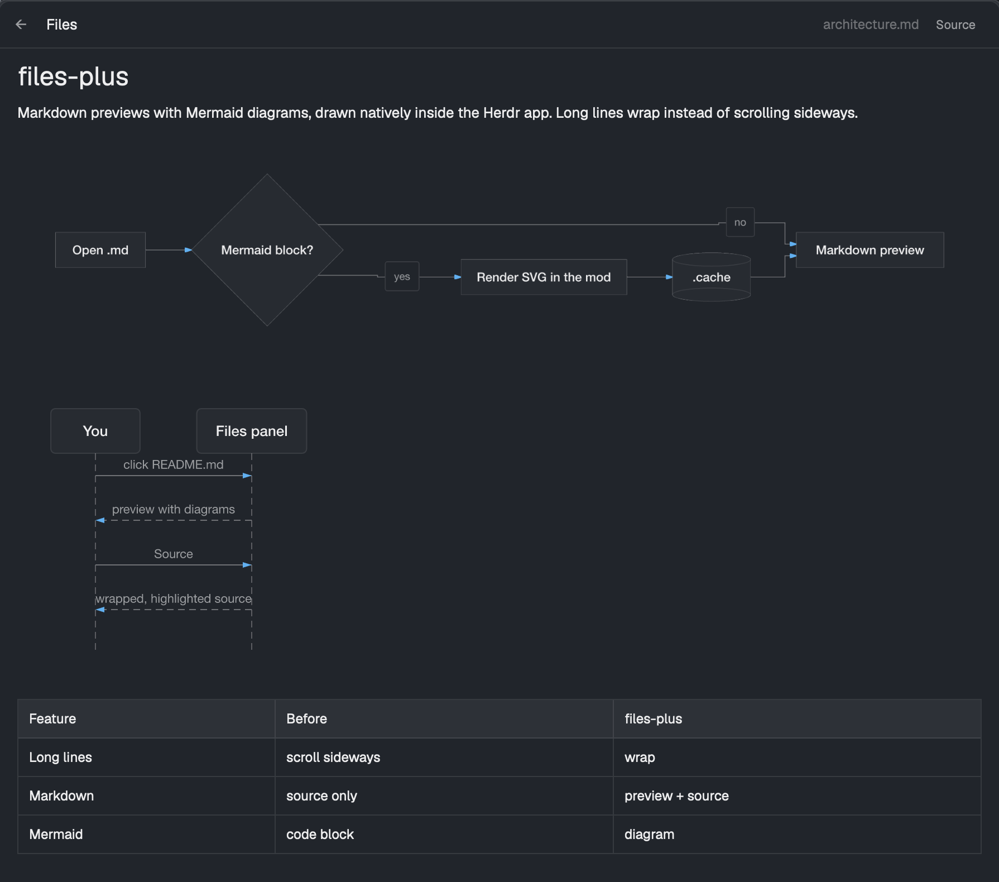

# files-plus, a Herdr mod

The Files panel of the [Herdr](https://herdr.dev) desktop app, with three changes:

- **Long lines wrap** in the source view instead of scrolling sideways.
- **Markdown and HTML previews.** `.md` and `.html` files open rendered, with a Source/Preview switch. HTML previews show structure (headings, lists, tables, links) but no CSS, so they also get an **Open in browser** button.
- **Mermaid diagrams** in Markdown previews, drawn natively in the panel. Nothing to install: the renderer ships inside the mod.

It also maps more file extensions to the editor's syntax highlighting (`py`, `rs`, `sh`, `zsh`, `h`/`hpp`, `yml`, `Makefile`, `.zshrc` and others).



## Install

```sh
git clone https://github.com/jjongkwann/herdr-files-plus.git
cp -R herdr-files-plus/mods/files-plus ~/.config/herdr-app/mods/
cp herdr-files-plus/layouts/main-files-plus.json ~/.config/herdr-app/layouts/
herdr-app do layout.switch --name main-files-plus
```

Copy the folder rather than symlinking it, since Herdr may not load the panel's icons from a symlinked mod folder. To update, pull and copy again.

`main-files-plus` is Herdr's own `main` layout (0.1.12) with the Files block pointing at `files-plus`. `ctrl-shift-l` switches back to any other layout.

### Your own layout

If you already use a layout of your own, change the Files block in it:

```json
{ "id": "files", "type": "block", "content": { "mod": "files-plus" } }
```

## Mermaid support

Diagrams are rendered by [beautiful-mermaid](https://github.com/lukilabs/beautiful-mermaid), bundled into `mods/files-plus/mermaid.bundle.js` (about 1.5 MB, loaded only when a document has a diagram). It draws:

- flowchart / graph
- sequenceDiagram
- classDiagram
- erDiagram
- stateDiagram-v2
- xychart-beta

Other diagram types (pie, gantt, mindmap, …) show Mermaid's error and the diagram source in place. Colors follow the Herdr theme; diagrams are rendered again when the theme changes.

Rendered diagrams are cached as SVG files in `~/.config/herdr-app/data/files-plus/`. They are small; delete the folder to clear it.

## What it runs

Nothing new compared with Herdr's Files panel (`sh`/PowerShell to list folders, `git status` for change marks), plus the system opener (`open`, `xdg-open` or `start`) when you press **Open in browser**. It makes no network requests.

## Development

```sh
npm install        # beautiful-mermaid and esbuild
npm run build      # rebuild mods/files-plus/mermaid.bundle.js
npm test
```

`build/build.mjs` patches two lines of elkjs at build time so it runs in Herdr's QuickJS mod runtime, which has frozen built-in prototypes and no `window`/`global`/`self`. The build fails if an elkjs update moves that code.

[RECIPE.md](RECIPE.md) is the brief to rebuild the mod from scratch.

## License

[MIT](LICENSE). The bundled renderer includes elkjs (EPL-2.0) and entities (BSD-2-Clause); see [THIRD_PARTY_NOTICES.md](THIRD_PARTY_NOTICES.md).
