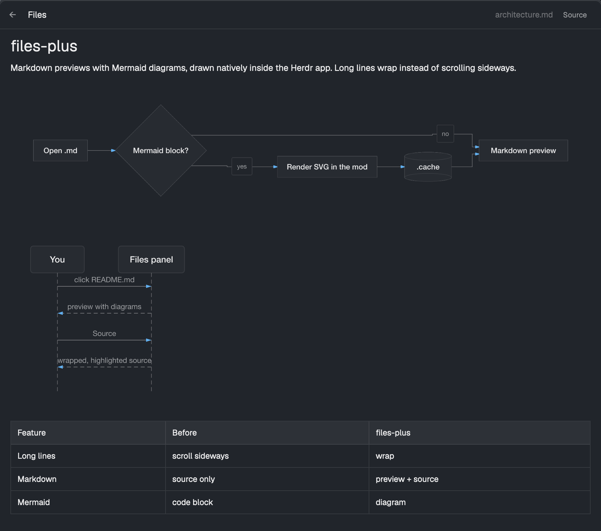

# files-plus

Herdr's Files panel with wrapped source, rendered Markdown and HTML previews, and Mermaid
diagrams drawn inside the panel. It replaces the `files` block of a layout and looks and
behaves like the shipped `files` mod (0.1.12) everywhere this brief doesn't say otherwise.



## What you see

The shipped Files panel: a 42px header with ← (when a file is open), the word "Files" and
the folder or file name on the right, then the tree of the focused pane's folder with git
change marks. Additions:

- **Header buttons**, after the file name, only while a previewable file is open: 11px text,
  `muted`, 7px side and 2px vertical padding, radius 6, `hover` background.
  - `Preview` / `Source` for `.md`, `.markdown`, `.mdx`, `.html`, `.htm`. The label names the
    view you switch to.
  - `Open in browser` for `.html` and `.htm` on this computer (not for remote spaces).
- **Source view**: the shipped read-only `Editor` with `soft_wrap: true`, font 12px in the
  terminal font, syntax colors from the theme (keyword `ansi5`, string `ansi2`, comment
  `dim`, function `ansi4`, type `ansi3`, number `ansi1`, constant `ansi6`).
- **Markdown preview** (the default view for Markdown): `TextView.markdown`, 16px side and
  10px vertical padding, selectable, scrolling.
- **HTML preview** (the default view for HTML): `TextView.html`, the same frame. No CSS.
- **Markdown with Mermaid**: the document is split at ```` ```mermaid ```` and
  `~~~mermaid` fences. One scrolling column (16px side, 10px vertical padding, 10px gaps)
  holds, in order, a non-scrolling `TextView.markdown` for each text part and an `image()`
  for each diagram, at its natural size, scaled down to the column width (minus 32px) with
  its aspect ratio kept. While a diagram renders, and when it fails, its place is a box
  with a 1px `border`, radius 6, 10px padding: `Rendering diagram…` in `dim`, or
  `Mermaid: <message>` in `ansi1` with the diagram source under it in the terminal font,
  12px, `muted`.

## How it behaves

- Opening a file reads at most 400,000 characters, as the shipped panel does. Markdown and
  HTML open in Preview; every other file opens in Source.
- Diagrams render one after another without blocking the panel. Each one becomes
  `data/files-plus/<hash>.svg` under the app folder, where the hash covers a render version,
  the source, the colors and the font. An existing file is reused, so reopening a document
  costs nothing. The image loader caches by path; changing the SVG output means bumping the
  render version.
- Colors come from `theme()`: `bg` = `background`, `fg` = `foreground`, `line` = `dim`,
  `accent` = `ansi4`, `muted` = `muted`, `border` = `border`; the SVG background is
  transparent. When the theme's colors change, the open document's diagrams render again.
- Font: `'Helvetica Neue', 'Segoe UI', Arial, 'Noto Sans', sans-serif`. The SVG loader
  finds real family names and `sans-serif`, but not `system-ui`; an unmatched family falls
  back to a serif face.
- `Open in browser` runs `open <file>` on macOS, `xdg-open <file>` on Linux and
  `cmd /c start "" <file>` on Windows.
- Language table: extensions map to the editor's grammar names where they differ (`ts`,
  `tsx`, `jsx`, `mjs`, `cjs` → `js`; `toml`, `yml` → `yaml`; `jsonc`, `json5` → `json`;
  `svelte`, `vue`, `astro`, `htm` → `html`; `svg`, `plist` → `xml`; `h` → `c`; `hpp`, `cc`,
  `cxx` → `cpp`; `csharp` → `cs`; `mk` → `make`; `el` → `lisp`; `ml` → `ocaml`; `hs` →
  `haskell`; `rake`, `gemspec` → `rb`), and file names without an extension by name
  (`Makefile`, `Gemfile`, `Rakefile`, `.zshrc`, `.bashrc`, `.profile` and friends). The editor
  has no grammar for Markdown, diff, Swift, Kotlin, Zig, proto, GraphQL, Elixir, CMake,
  Dockerfile, Dart, Objective-C or Nix; those stay plain.

## The Mermaid renderer

The mod runtime is QuickJS with no DOM, so Mermaid itself can't run.
[beautiful-mermaid](https://github.com/lukilabs/beautiful-mermaid) lays diagrams out with
elkjs and writes SVG strings without a DOM. `build/build.mjs` bundles it with esbuild into
one ES module, `mermaid.bundle.js` (minified, about 1.5 MB), which `mermaid.js` imports with
a dynamic `import()` on the first diagram so the mod itself stays small.

Two things in elkjs need patching at build time, each applied exactly once or the build
fails:

1. Built-in prototypes are frozen, so `_.toString=function(){return this.Ib()}` throws
   "'toString' is read-only". It becomes `Object.defineProperty(_,"toString",{...})`.
2. There is no `window`, `global` or `self`, so GWT's `$wnd` falls back to `globalThis`.

The bundle entry also defines a `setTimeout` that throws for non-zero delays: elkjs only asks
for zero-delay ones, which beautiful-mermaid drains itself.

The SVG that beautiful-mermaid writes relies on CSS custom properties and `color-mix()` and
imports a web font; the native SVG loader supports none of these. `flattenSvg` resolves every
`var(--…)` and `color-mix(in srgb, …)` to a hex color, drops the declarations and the
`@import`, and sets one `font-family`.

## Built from

- `mods/files-plus/main.js`: the shipped `files` mod 0.1.12, extended. `mod.json`:
  `{ "place": "none", "cloned_from": { "name": "files", "version": "0.1.12" } }`.
- `mods/files-plus/mermaid.js`: `splitMermaid`, `flattenSvg`, `colorsFor`, `renderToFile`.
- `mods/files-plus/mermaid.bundle.js`: build output, committed so installing needs no tools.
- `layouts/main-files-plus.json`: the shipped `main` layout 0.1.12 with `files` → `files-plus`.
- `herdr` functions: `exec`, `readTextFile`, `writeTextFile`, `appHome`, `watchFolder`,
  `spaces`, `panes`, `focused`, `theme`, `settings`, `window`. `gpui-kit`: `View`, `div`,
  `svg`, `image`; `gpui-base`: `v_flex`, `h_flex`, `Editor`, `EditorState`, `TextView`.
